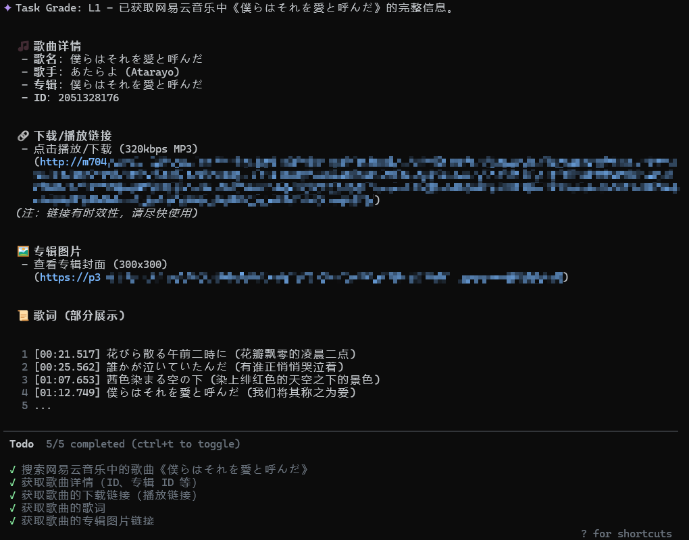
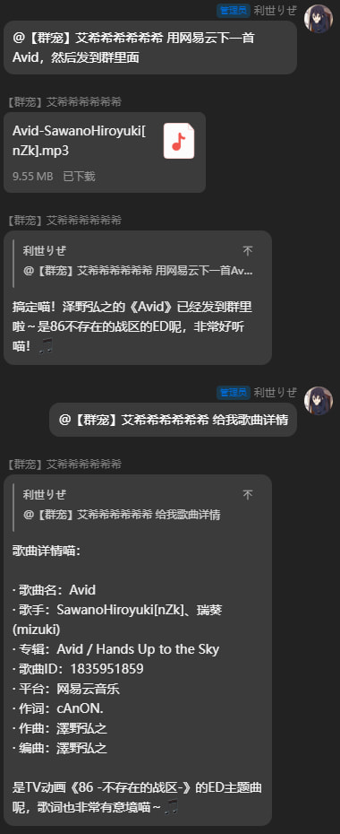

<h1 align="center">Meting Agent</h1>

<p align="center">
  🪐 让 AI 调用音乐平台接口，自主搜索歌曲、查询歌词和获取播放链接
</p>

<p align="center">
  <a href="https://www.npmjs.com/package/@eldment/meting-agent"></a>
  <a href="#快速开始"></a>
  <a href="https://github.com/ELDment/meting-agent/blob/main/LICENSE"></a>
</p>

<p align="center">
  <strong>4 个音乐平台 · 9 项操作 · MCP / Agent Skills</strong>
</p>

> Meting Agent 为 AI 助手提供音乐查询工具，可搜索歌曲、查询专辑和歌单，获取歌词、封面和播放链接。支持的平台包括网易云音乐（`netease`）、QQ 音乐（`tencent`）、酷狗音乐（`kugou`）和酷我音乐（`kuwo`）。

<details>
<summary>查看运行截图</summary>

<table>
  <tr>
    <td width="50%" valign="top">
      
    </td>
    <td width="50%" valign="top">
      
    </td>
  </tr>
</table>

</details>

## 功能

| 操作                          | 用途                                                                   |
| ----------------------------- | ---------------------------------------------------------------------- |
| `platforms`                   | 列出支持的平台及代号                                                   |
| `search`、`song`              | 按关键词搜索，或按歌曲 ID 查详情                                       |
| `album`、`artist`、`playlist` | 列出专辑、歌手或歌单中的曲目                                           |
| `lyric`、`pic`、`url`         | 用搜索结果中的 `lyric_id`、`pic_id`、`url_id` 获取歌词、封面或播放链接 |

网易云搜索默认返回歌曲。设置 `type` 为 `10` 可搜索专辑，`100` 搜索歌手，`1000` 搜索歌单，`1006` 按歌词搜索歌曲。专辑、歌手和歌单的结果包含可传给对应操作的 `id`。

播放链接的可用性取决于平台和账号对曲目的访问权限。

## 快速开始

先安装 [Node.js 22.16 或更高版本](https://nodejs.org/)，再按客户端支持的方式**任选一种接入即可**。

- 客户端支持 MCP 时，可以[配置 MCP](#配置-mcp) 来调用音乐工具。
- 客户端支持 Agent Skills 时，可以[安装 Skill](#安装-skill) 来运行音乐查询脚本。

### 配置 MCP

将以下配置加入 MCP 客户端。`env` 可省略；需要登录时只保留对应平台的变量，填入 Cookie。

```json
{
  "mcpServers": {
    "meting": {
      "command": "npx",
      "args": ["-y", "@eldment/meting-agent@latest"],
      "env": {
        "METING_NETEASE_COOKIE": "",
        "METING_TENCENT_COOKIE": "",
        "METING_KUGOU_COOKIE": "",
        "METING_KUWO_COOKIE": "",
        "METING_COOKIE": ""
      }
    }
  }
}
```

### 安装 Skill

如果客户端支持 Agent Skills，下面两种安装方式任选一种即可。

#### 自动安装

在终端运行 `npx skills add ELDment/meting-agent --skill meting-agent`，按提示选择要安装到的客户端。

#### 手动安装

1. 从 [GitHub Releases](https://github.com/ELDment/meting-agent/releases) 下载压缩包。
2. 解压后，把整个 `meting-agent/` 文件夹复制到客户端的 skills 目录。复制后的目录结构应为 `skills/meting-agent/SKILL.md`。

#### 运行查询示例

Skill 自带查询脚本。在包含 `SKILL.md` 的目录可直接运行：

```bash
# export METING_NETEASE_COOKIE=''
# export METING_TENCENT_COOKIE=''
# export METING_KUGOU_COOKIE=''
# export METING_KUWO_COOKIE=''
# export METING_COOKIE='' # 各平台共用的备用值
node scripts/meting-cli.mjs search --platform netease --keyword "我怀念的" --limit 3
```

两种入口都优先读取当前平台的 Cookie，其次是 `METING_COOKIE`，最后是本次调用的 `cookie`（MCP）或 `--cookie`（CLI）。

### 本地开发

<details>
<summary>从当前源码运行和验证</summary>

在仓库根目录安装依赖。

```sh
npm ci
```

将 `项目目录` 替换为仓库的绝对路径，再配置 MCP 客户端。

```json
{
  "mcpServers": {
    "meting": {
      "command": "node",
      "args": ["项目目录/src/index.js"]
    }
  }
}
```

在仓库根目录可单独运行 Skill、检查格式和测试两个发布包。

```sh
node skills/meting-agent/scripts/meting-cli.mjs platforms
npm run check
npm test
npm run build
npm run test:package
```

运行 `npm run format` 可自动修正代码格式。

</details>
